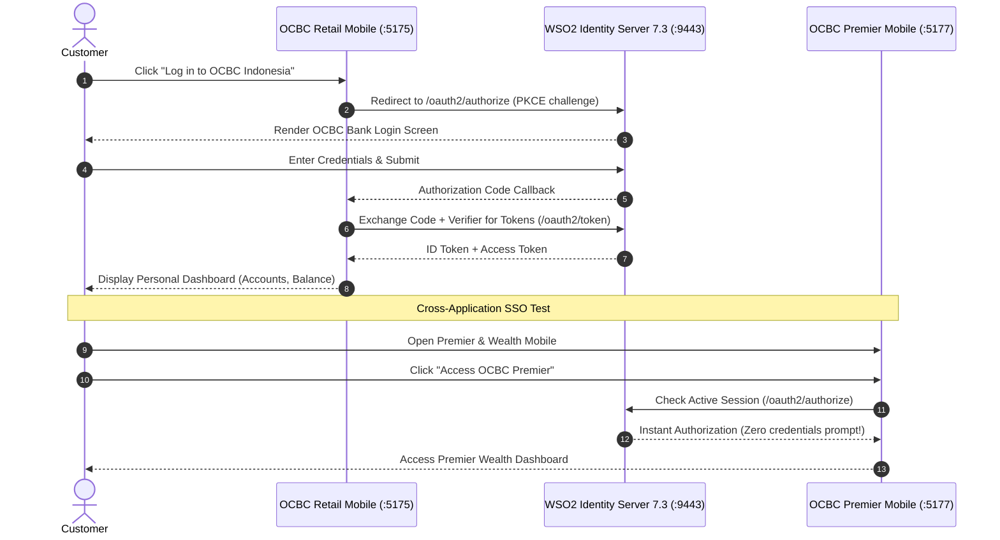

# OCBC Bank — Mobile Banking SSO Demo (App 1)

<div align="center">


<p align="center">
  A high-fidelity mobile banking application for <b>OCBC Indonesia</b> showcasing enterprise-grade <b>Single Sign-On (SSO)</b> and <b>Cross-App Authentication</b> powered by <b>WSO2 Identity Server 7.3</b>.
</p>

[Live Demo](https://ocbc-bank-demo-app.vercel.app/) • [Features](#-features) • [Architecture](#-architecture) • [Getting Started](#-getting-started) • [WSO2 Setup](#-wso2-identity-server-73-setup)

</div>

---

## 🏦 Project Overview

This repository demonstrates how modern financial institutions like **OCBC Bank** implement secure, seamless OpenID Connect (OIDC) Single Sign-On across multiple digital channels using **WSO2 Identity Server 7.3**.

Users authenticate once via bank-grade OIDC Authorization Code Flow with **PKCE (Proof Key for Code Exchange)**. When navigating between companion applications (such as the Retail Mobile Banking App and the Premier Wealth Portal), the user experiences instant cross-app authorization without entering their password again.

---

## ✨ Features

- 📱 **Native-Feel Mobile UI**: Realistic iOS mobile device mockup complete with dynamic status bar, notch, and smooth touch-optimized interactions.
- 🔐 **Bank-Grade Authentication**: Integrated with `@asgardeo/auth-react` implementing OIDC Authorization Code Flow + PKCE.
- 🔄 **Cross-Application SSO**: Seamless shared session with companion applications:
  - **App 1 (This App):** OCBC Retail Mobile Banking (`http://localhost:5175` / Vercel)
  - **App 2:** OCBC Premier & Wealth Mobile (`http://localhost:5177`)
  - **App 1 Web Portal:** OCBC Retail Web Portal (`http://localhost:5173`)
  - **App 2 Web Portal:** OCBC Premier & Wealth Web Portal (`http://localhost:5176`)
- 🛡️ **Session Management**: Secure token lifecycle handling using `sessionStorage` (cleared automatically on tab close to protect customer account data).
- 👤 **Customer Profile Integration**: Displays authenticated user claims (Display Name, Given Name, Email, Sub) retrieved directly from WSO2 IS user store.
- 💳 **Banking Dashboard**: Includes real-time account balances, debit card details, quick actions (PayNow, Scan & Pay, Bill Payments), and promotional alerts.

---

## 📐 Architecture & SSO Flow



---

## 🚀 Getting Started

### Prerequisites

- **Node.js**: v18.0.0 or higher
- **npm** or **pnpm**
- **WSO2 Identity Server 7.3.0** (running locally or remotely)

### 1. Installation

```bash
# Clone the repository
git clone https://github.com/dulithakariyapperuma/ocbc-bank-demo-app-.git

# Navigate into the project folder
cd ocbc-bank-demo-app-

# Install dependencies
npm install
```

### 2. Configure Authentication

Open `src/main.jsx` and ensure your WSO2 IS Client ID and URLs are configured:

```javascript
const authConfig = {
  clientID: "YOUR_WSO2_CLIENT_ID",
  baseUrl: "https://localhost:9443",
  signInRedirectURL: "https://ocbc-bank-demo-app.vercel.app/", // or "http://localhost:5175"
  signOutRedirectURL: "https://ocbc-bank-demo-app.vercel.app/", // or "http://localhost:5175"
  scope: ["openid", "profile", "email"],
  storage: "sessionStorage",
};
```

### 3. Run Development Server

```bash
npm run dev
```

Open your browser at: **`http://localhost:5175`** (or the port assigned by Vite).

---

## ⚙️ WSO2 Identity Server 7.3 Setup

1. **Start WSO2 IS 7.3**:
   ```bash
   cd wso2is-7.3.0/bin
   sh wso2server.sh
   ```
2. **Access Management Console**: Navigate to `https://localhost:9443/console` (`admin` / `admin`).
3. **Register Single Page Application (SPA)**:
   - Go to **Applications** → **New Application** → **Single Page Application**.
   - **Name:** `OCBC-Bank-Mobile-Demo`
   - **Authorized Redirect URLs:**
     - `http://localhost:5175`
     - `https://ocbc-bank-demo-app.vercel.app/`
   - **Allowed Origins:**
     - `http://localhost:5175`
     - `https://ocbc-bank-demo-app.vercel.app`
4. **Copy Client ID**: Copy the generated Client ID from the **Protocol** tab into your configuration.

---

## 🛠️ Tech Stack

| Layer | Technology |
|---|---|
| **Framework** | [React 19](https://react.dev/) |
| **Build Tool** | [Vite 8](https://vite.dev/) |
| **Identity SDK** | [@asgardeo/auth-react](https://github.com/asgardeo/asgardeo-auth-react-sdk) |
| **Identity Provider (IdP)** | [WSO2 Identity Server 7.3](https://is.docs.wso2.com/en/7.3.0/) |
| **Protocol** | OpenID Connect (OIDC) + PKCE |
| **Styling** | Vanilla CSS (iOS Mobile Shell) |
| **Deployment** | [Vercel](https://vercel.com/) |

---

## 📄 License

This demonstration project is licensed under the MIT License.
